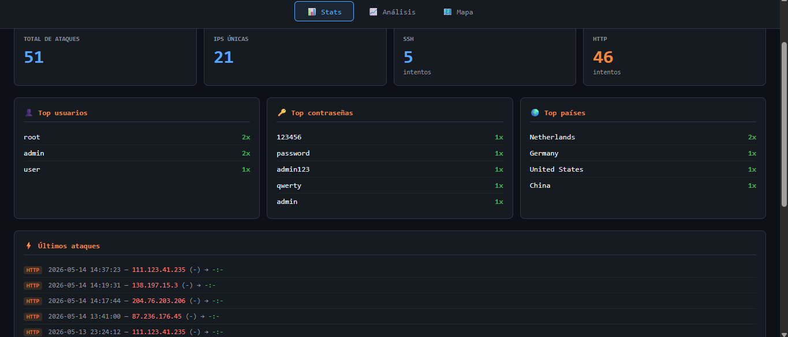
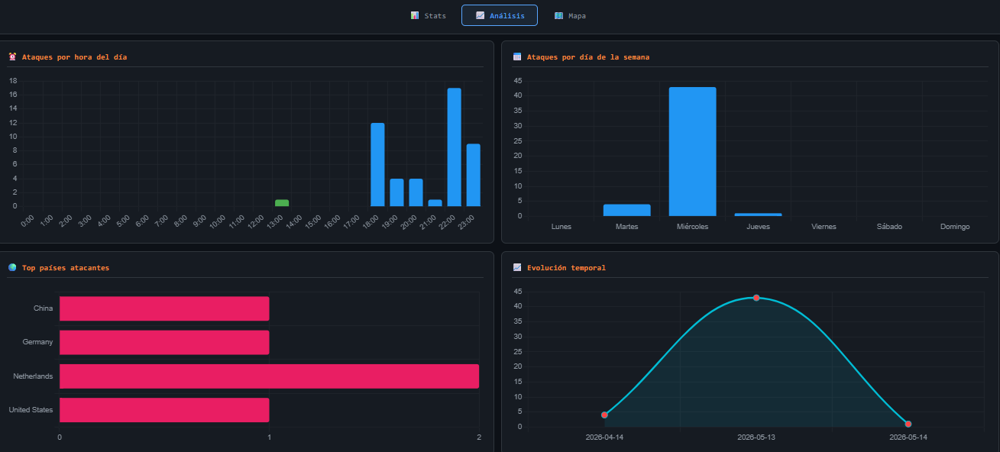
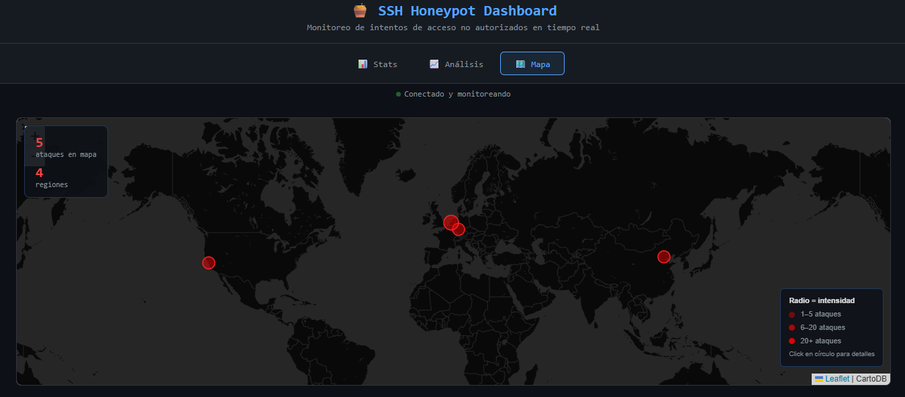
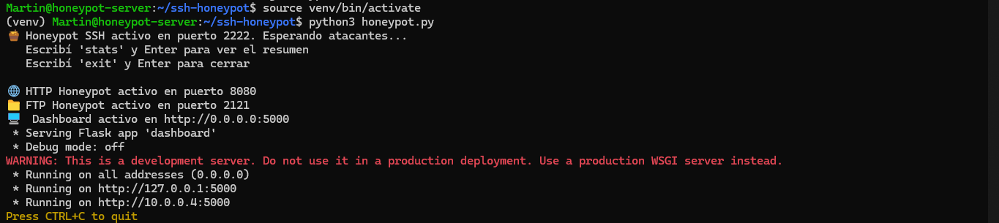
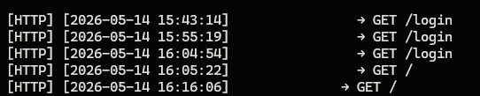

# SSH Honeypot

**[English](#english) | [Español](#español)**

---

## English

A honeypot is a decoy server. It looks real and accepts connections, but there is nothing of value inside. Its only job is to attract attackers and log what they do. This project fakes three services (SSH, HTTP and FTP). It first ran on an Azure VM and now runs in Docker on AWS EC2, exposed to the internet and taking traffic from real attackers. A Wazuh agent ships its logs to a Wazuh manager, where [custom detection rules](https://github.com/TinchoLay/wazuh-detection-pack/tree/main/honeypot) turn them into alerts.

This is a learning project. The honeypot only captures traffic aimed at a server I own.

### What it does

Someone connects to one of the open ports, thinking they found a real server. The honeypot lets them in, records the username and password they tried and looks up where the IP comes from. From there:

- A machine learning model guesses what kind of attacker it is: a bot going through thousands of combinations, or someone slower who is aiming at this server.
- It reads the banner the SSH client sends on connect, which often gives away the tool (Hydra, Metasploit, a home-made script).
- If the attacker tries `wget` or `curl`, the honeypot lets them think it worked and downloads the real file in the background to analyze it.
- It checks the IP against AbuseIPDB and Shodan.
- Everything shows up live on a web dashboard.

### The three fake services

- **SSH (2222, and 22 through a port forward):** the most built-out one. It opens a fake interactive shell that imitates Ubuntu 22.04. The attacker can type `ls`, `cd`, `whoami` or `cat /etc/passwd` and gets plausible answers. Everything they type is logged.
- **HTTP (8080):** a fake admin panel styled after a TP-Link router. It catches scanners looking for poorly secured admin pages. It stores the method, path, headers and POST body.
- **FTP (2121):** accepts the connection and rejects every credential. It shows which usernames and passwords get tried there.

### Making it harder to spot

A honeypot that is easy to recognize only collects traffic from the laziest bots. I made these changes after thinking about how a scanner would fingerprint it:

- **Persistent host key.** It used to generate a new key on every start, which is the kind of thing a returning scanner notices. The key now lives in `logs/` and survives restarts.
- **Full banner.** The SSH version string matches a real Ubuntu 22.04 OpenSSH build.
- **Believable authentication.** The login is accepted if the password is in a list of weak and default credentials (`weak_passwords.py`, 69 entries from common password lists and IoT defaults), or on the third attempt from the same IP within 10 minutes. A server that accepts everything on the first try looks fake.
- **A shell that remembers where you are.** `cd`, `pwd` and `ls` work against a small fake filesystem. A fresh home directory is empty, `ls -la` shows the dotfiles, `/` lists the usual directories and `/root` gives "Permission denied" to normal users. The prompt follows the current directory.
- **Per-user output.** `whoami`, `id` and the "Last login" line match the user who logged in.

These are my own measures against fingerprinting. I have not tested them against a scanner built to detect honeypots, so I do not claim the honeypot is undetectable.

### How attacker classification works

A Random Forest trained on the data the honeypot captures, retrained automatically every 100 attempts. It sorts attackers into four groups:

- `bot_fuerza_bruta`: automated scripts going through credentials at high speed
- `scanner`: sweeping ports and services without trying to break into anything specific
- `script_kiddie`: using known tools such as Hydra without much strategy
- `atacante_dirigido`: slower and more human, seemingly aimed at this server

### Malware analysis

When someone pulls a file, the honeypot downloads it in the background, computes its MD5 and SHA256 and checks the hash against VirusTotal. The result is saved with the number of engines that flagged it. Wazuh rule 100320 fires when at least one engine does.

### Dashboard

A Flask and WebSockets panel that updates when a new attack arrives. Three tabs:

- **Stats:** totals per protocol, most tried usernames and passwords, countries of origin and a live log.
- **Analysis:** charts of attacks by hour of day and day of week, and where from.
- **Map:** every SSH, HTTP and FTP event on a world map, with two filters that combine. Type: all, SSH, HTTP or FTP. Period: last hour, 24 hours, 3 days, week, month or since the beginning. So "FTP in the last 24 hours" is one click each.

The map uses OpenStreetMap tiles. I first used CARTO tiles and they started asking for an API key, which turned the map into an error message. Updates are debounced by 1.5 seconds, because with port 22 open every event reloaded the logs and re-sent everything, and the cost grew with each connection.

The dashboard listens on `127.0.0.1:5000` only. It is not exposed to the internet, so reach it through an SSH tunnel.











### Detection with Wazuh

The honeypot writes one JSON line per event and a Wazuh agent on the same machine ships it to a manager. The rules (SSH brute force fast and slow, download attempts, VirusTotal hits, GPON exploit paths, open proxy probes, scanner targets, anonymous FTP) live in the [wazuh-detection-pack](https://github.com/TinchoLay/wazuh-detection-pack/tree/main/honeypot) repository, with the tests I ran and what I could not verify.

### Using port 22

Scanners try port 22 first, so a honeypot that only listens on 2222 sees little. The admin `sshd` on this machine stays on 22, key-only. To catch the traffic I forward port 22 to the container with a DNAT rule in the `nat` table:

```bash
CIP=$(sudo docker inspect -f '{{range .NetworkSettings.Networks}}{{.IPAddress}}{{end}}' ssh-honeypot)
sudo iptables -t nat -A PREROUTING -p tcp --dport 22 -j DNAT --to-destination $CIP:2222
```

Two details cost me time:

- **Why DNAT and not a redirect to 2222.** Port 2222 is published by Docker through `docker-proxy`. If you redirect to that port, every attacker reaches the container as the bridge address and the real source IP is lost. That breaks the geolocation and every detection that counts attempts per IP. DNAT straight to the container address keeps the source.
- **The rule does not survive a reboot, and the container address can change after a rebuild.** After `docker compose up --build`, delete the old rule (`iptables -t nat -D PREROUTING <n>`) and add it again with the new address. After a reboot the real `sshd` answers on 22 again, which is the safe way to fail.

The security group has to allow port 22 inbound, and then anyone on the internet can reach that port. Do this only on a machine built for it.

### Ignoring my own traffic

Testing from home put my own connections in the logs. The `HONEYPOT_IGNORE_IPS` variable takes a comma-separated list of IPs or CIDR ranges that every collector skips (SSH, HTTP, FTP, shell commands and malware capture). Put it in a `.env` file, which is gitignored. Use exact IPs: an ISP range such as a /24 also hides other customers of the same provider.

This only helps going forward. Events that were already logged have to be cleaned by hand.

### Geolocation of older events

HTTP and FTP events used to be stored without coordinates, so they did not appear on the map. `backfill_geo.py` fills country, city, ISP and coordinates for the old events:

```bash
sudo docker compose exec honeypot python backfill_geo.py --dry-run
sudo docker compose exec honeypot python backfill_geo.py
```

It makes one lookup per unique IP and waits between requests to stay under the free rate limit of ip-api.com (about 45 per minute). In my last run it updated 183 events from 89 IPs, with none left without data.

### Project structure

```
honeypot-aws/
├── honeypot.py          # Entry point, starts all services
├── fake_shell.py        # Fake interactive SSH shell and authentication
├── weak_passwords.py    # Weak and default credentials that get accepted
├── http_honeypot.py     # HTTP honeypot server
├── ftp_honeypot.py      # FTP honeypot server
├── logger.py            # Central logging and geolocation
├── shell_logger.py      # Logs executed commands
├── stats.py             # Console stats
├── mapa.py              # Static map generator (folium)
├── dashboard.py         # Flask and WebSockets dashboard
├── ml_classifier.py     # ML attacker classification
├── fingerprint.py       # Tool identification
├── malware_capture.py   # Malware capture and analysis
├── threat_intel.py      # AbuseIPDB and Shodan lookups
├── alertas.py           # Email alert system
├── backfill_geo.py      # Fills coordinates for old HTTP/FTP events
├── config.py            # Central config
├── Dockerfile
├── docker-compose.yml
├── requirements.txt
└── logs/                # Generated at runtime, not in the repo
    ├── attempts.json
    ├── http_attempts.json
    ├── ftp_attempts.json
    ├── shell_commands.json
    ├── fingerprints.json
    ├── ml_classifications.json
    ├── malware_captures.json
    ├── threat_intel.json
    ├── ssh_host_rsa_key
    └── malware_samples/
```

### Tech stack

| Category | Technology |
|---|---|
| Language | Python 3.11 |
| SSH protocol | paramiko |
| Web framework | Flask and Flask-SocketIO |
| Machine learning | scikit-learn (Random Forest) |
| Maps | Leaflet.js with OpenStreetMap tiles, folium for the static map |
| Visualization | Chart.js |
| Detection | Wazuh 4.14.8 (agent and manager) |
| Infrastructure | AWS EC2, Docker and Docker Compose (first run on Azure) |

### External services it depends on

| Service | Used for | If it is down or limited |
|---|---|---|
| ip-api.com | Geolocation of every IP (free tier, about 45 requests per minute) | Events are logged without coordinates. `backfill_geo.py` can fill them later |
| OpenStreetMap tile servers | Map background | The map shows markers on an empty background |
| AbuseIPDB and Shodan | IP reputation (optional, needs API keys) | Disabled unless `THREAT_INTEL_ENABLED=true` |
| VirusTotal | Hash check of captured files (optional, needs an API key) | The hash is stored with no verdict |

The dashboard also loads Leaflet, Chart.js and Socket.IO in the browser.

### Local setup

Requirements: Python 3.9 or newer and pip.

```bash
git clone https://github.com/TinchoLay/ssh-honeypot.git
cd ssh-honeypot

python -m venv venv

# Windows:
venv\Scripts\activate
# Linux and Mac:
source venv/bin/activate

pip install -r requirements.txt
python honeypot.py
```

The dashboard runs at `http://localhost:5000`.

### Running it on a server

1. Create an Ubuntu VM (I used Azure first and EC2 now) and install Docker.
2. In the cloud firewall, open 2222, 8080 and 2121. Keep the dashboard port closed and use an SSH tunnel for it. Open 22 only if you use the port forward above.
3. Clone the repo, create a `.env` file if you need one and start it:

```bash
git clone https://github.com/TinchoLay/ssh-honeypot.git
cd ssh-honeypot
docker compose up -d --build
```

When you rebuild, check that the build output does not say `CACHED` for the steps you changed, or the old code keeps running.

### Environment variables

```bash
GEO_ENABLED=true              # IP geolocation (default: true)
HONEYPOT_IGNORE_IPS=          # Comma-separated IPs or CIDR ranges to skip
EMAIL_ENABLED=false           # Email alerts (default: false)
EMAIL_SENDER=your@gmail.com
EMAIL_PASSWORD=app_password
EMAIL_RECEIVER=destination@gmail.com
ALERT_THRESHOLD=5             # Attempts before alerting (default: 5)
ALERT_WINDOW=60               # Time window in seconds (default: 60)
THREAT_INTEL_ENABLED=false    # AbuseIPDB and Shodan lookups (default: false)
ABUSEIPDB_KEY=your_api_key
SHODAN_KEY=your_api_key
VIRUSTOTAL_KEY=your_api_key
```

### What real internet traffic looks like

- The first attempts arrive within minutes. I did not advertise the server anywhere.
- SSH on 2222 was quiet. The few attempts used default usernames and weak passwords: `root`, `admin` and `user` with `123456`, `password`, `admin123`, `qwerty` and `admin`.
- HTTP traffic comes mostly from scanners looking for admin panels (`/login`, `/admin`, `/wp-admin`), WordPress, Jenkins and exposed config files. There were also GPON router exploit attempts and open proxy probes.
- The most active IPs trace back to Tor exit nodes, VPS ranges and Chinese IP blocks.
- The bots are very regular, with milliseconds between attempts.

My latest dashboard count on the AWS instance was 247 events from 111 unique IPs (241 HTTP, 5 SSH). That is before opening port 22, so SSH is expected to change a lot. I will update this section once port 22 has collected data. It is a small sample, but it is real traffic.

### What I learned building this

- How SSH works inside: key negotiation, authentication and channels.
- Raw TCP servers with Python's `socket` module, and paramiko to control SSH sessions.
- Flask with WebSockets to keep a dashboard updating live, and why every event reloading everything stops scaling.
- Training and wiring a scikit-learn model with real captured data.
- Consuming REST APIs and living with their rate limits (ip-api, AbuseIPDB, Shodan, VirusTotal).
- Cloud networking and firewall rules, and how Docker's port publishing hides the source IP.
- Concurrency with `threading`.
- The unglamorous production side: running in the background, not losing logs, restarting after a crash, and cleaning my own traffic out of the data.
- Realism is an arms race. Every detail that is wrong is something a scanner can fingerprint.

### Ethics and legal notes

This project exists to learn cybersecurity. The honeypot only captures data from people trying to get into a server that is mine, without permission. Do not use it against systems that are not yours or for anything malicious.

### Author

Martín, IT support and cybersecurity, working toward a SOC L1 role.

[GitHub](https://github.com/TinchoLay) · [LinkedIn](https://www.linkedin.com/in/martin-chancalay-902b543a8)

---

## Español

Un honeypot es un servidor señuelo. Parece real y acepta conexiones, pero no tiene nada de valor adentro. Su único trabajo es atraer atacantes y registrar lo que hacen. Este proyecto simula tres servicios (SSH, HTTP y FTP). Primero corrió en una VM de Azure y ahora corre en Docker sobre AWS EC2, expuesto a internet y recibiendo tráfico de atacantes reales. Un agente de Wazuh manda sus logs a un manager de Wazuh, donde unas [reglas de detección propias](https://github.com/TinchoLay/wazuh-detection-pack/tree/main/honeypot) los convierten en alertas.

Es un proyecto para aprender. El honeypot solo captura tráfico dirigido a un servidor que es mío.

### Qué hace

Alguien se conecta a uno de los puertos abiertos, pensando que encontró un servidor de verdad. El honeypot lo deja entrar, guarda el usuario y la contraseña que probó y ubica de dónde viene la IP. A partir de ahí:

- Un modelo de machine learning intenta adivinar qué tipo de atacante es: un bot que prueba miles de combinaciones, o alguien más lento que apunta a este servidor.
- Lee el banner que manda el cliente SSH al conectarse, que muchas veces delata la herramienta (Hydra, Metasploit, un script casero).
- Si el atacante intenta `wget` o `curl`, el honeypot lo deja creer que funcionó y descarga el archivo real en segundo plano para analizarlo.
- Cruza la IP contra AbuseIPDB y Shodan.
- Todo aparece en vivo en un dashboard web.

### Los tres servicios falsos

- **SSH (2222, y 22 mediante un reenvío de puerto):** el más elaborado. Abre una shell interactiva falsa que imita Ubuntu 22.04. El atacante puede tipear `ls`, `cd`, `whoami` o `cat /etc/passwd` y recibe respuestas creíbles. Todo lo que escribe queda registrado.
- **HTTP (8080):** un panel de administración falso con la pinta de un router TP-Link. Atrapa scanners que buscan paneles mal protegidos. Guarda el método, la ruta, los headers y el cuerpo del POST.
- **FTP (2121):** acepta la conexión y rechaza cualquier credencial. Muestra qué usuarios y contraseñas se prueban ahí.

### Hacerlo más difícil de detectar

Un honeypot fácil de reconocer solo junta tráfico de los bots más vagos. Hice estos cambios después de pensar cómo lo identificaría un scanner:

- **Clave de host persistente.** Antes generaba una clave nueva en cada arranque, algo que un scanner que vuelve nota enseguida. Ahora la clave vive en `logs/` y sobrevive a los reinicios.
- **Banner completo.** La cadena de versión de SSH coincide con una build real de OpenSSH de Ubuntu 22.04.
- **Autenticación creíble.** El login se acepta si la contraseña está en una lista de credenciales débiles y de fábrica (`weak_passwords.py`, 69 entradas de listas de contraseñas comunes y defaults de IoT), o al tercer intento desde la misma IP dentro de 10 minutos. Un servidor que acepta todo al primer intento parece falso.
- **Una shell que recuerda dónde estás.** `cd`, `pwd` y `ls` funcionan sobre un filesystem falso chico. Un home recién creado está vacío, `ls -la` muestra los dotfiles, `/` lista los directorios de siempre y `/root` da "Permission denied" a los usuarios comunes. El prompt sigue el directorio actual.
- **Salida según el usuario.** `whoami`, `id` y la línea "Last login" coinciden con el usuario que entró.

Son medidas propias contra el fingerprinting. No las probé contra un scanner hecho para detectar honeypots, así que no afirmo que sea indetectable.

### Cómo clasifica a los atacantes

Un Random Forest entrenado con los datos que captura el honeypot, que se reentrena solo cada 100 intentos. Los separa en cuatro grupos:

- `bot_fuerza_bruta`: scripts automáticos que prueban credenciales a toda velocidad
- `scanner`: barre puertos y servicios sin intentar entrar en algo puntual
- `script_kiddie`: usa herramientas conocidas como Hydra sin mucha estrategia
- `atacante_dirigido`: más lento y más humano, parece apuntar a este servidor

### Análisis de malware

Cuando alguien baja un archivo, el honeypot lo descarga en segundo plano, calcula su MD5 y SHA256 y consulta el hash en VirusTotal. El resultado queda guardado con la cantidad de motores que lo marcaron. La regla 100320 de Wazuh salta cuando al menos un motor lo hace.

### Dashboard

Un panel con Flask y WebSockets que se actualiza cuando entra un ataque nuevo. Tiene tres pestañas:

- **Stats:** totales por protocolo, usuarios y contraseñas más probados, países de origen y un log en vivo.
- **Análisis:** gráficos de ataques por hora del día y día de la semana, y desde dónde.
- **Mapa:** todos los eventos SSH, HTTP y FTP en un mapa mundial, con dos filtros que se combinan. Tipo: todos, SSH, HTTP o FTP. Período: última hora, 24 horas, 3 días, semana, mes o desde el inicio. Así, "FTP de las últimas 24 horas" son un clic en cada filtro.

El mapa usa tiles de OpenStreetMap. Al principio usé los de CARTO y empezaron a pedir una API key, lo que convirtió el mapa en un mensaje de error. Las actualizaciones se agrupan con un retraso de 1,5 segundos, porque con el puerto 22 abierto cada evento recargaba los logs y reenviaba todo, y el costo crecía con cada conexión.

El dashboard escucha solo en `127.0.0.1:5000`. No está expuesto a internet, así que se accede por un túnel SSH.


### Detección con Wazuh

El honeypot escribe una línea JSON por evento y un agente de Wazuh en la misma máquina la manda a un manager. Las reglas (fuerza bruta SSH rápida y lenta, intentos de descarga, hallazgos de VirusTotal, rutas de exploit de GPON, pruebas de proxy abierto, objetivos de scanners, FTP anónimo) están en el repositorio [wazuh-detection-pack](https://github.com/TinchoLay/wazuh-detection-pack/tree/main/honeypot), con las pruebas que hice y lo que no pude verificar.

### Usar el puerto 22

Los scanners prueban primero el puerto 22, así que un honeypot que solo escucha en el 2222 ve poco. El `sshd` de administración de esta máquina queda en el 22, solo con clave. Para atrapar el tráfico reenvío el puerto 22 al contenedor con una regla DNAT en la tabla `nat`:

```bash
CIP=$(sudo docker inspect -f '{{range .NetworkSettings.Networks}}{{.IPAddress}}{{end}}' ssh-honeypot)
sudo iptables -t nat -A PREROUTING -p tcp --dport 22 -j DNAT --to-destination $CIP:2222
```

Dos detalles me hicieron perder tiempo:

- **Por qué DNAT y no una redirección al 2222.** El puerto 2222 lo publica Docker a través de `docker-proxy`. Si redirigís a ese puerto, todos los atacantes llegan al contenedor con la dirección del bridge y se pierde la IP de origen real. Eso rompe la geolocalización y toda detección que cuente intentos por IP. DNAT directo a la dirección del contenedor conserva el origen.
- **La regla no sobrevive a un reinicio y la dirección del contenedor puede cambiar después de reconstruirlo.** Después de `docker compose up --build`, borrá la regla vieja (`iptables -t nat -D PREROUTING <n>`) y agregala de nuevo con la dirección nueva. Después de un reinicio vuelve a responder el `sshd` real en el 22, que es la forma segura de fallar.

El security group tiene que permitir el puerto 22 de entrada, y entonces cualquiera en internet llega a ese puerto. Hacelo solo en una máquina pensada para esto.

### Ignorar mi propio tráfico

Probar desde casa metió mis propias conexiones en los logs. La variable `HONEYPOT_IGNORE_IPS` recibe una lista separada por comas de IPs o rangos CIDR que todos los colectores saltean (SSH, HTTP, FTP, comandos de la shell y captura de malware). Va en un archivo `.env`, que está en el gitignore. Usá IPs exactas: un rango del proveedor como un /24 también oculta a otros clientes del mismo proveedor.

Solo sirve hacia adelante. Los eventos que ya se registraron hay que limpiarlos a mano.

### Geolocalización de eventos viejos

Los eventos HTTP y FTP se guardaban sin coordenadas, así que no aparecían en el mapa. `backfill_geo.py` completa país, ciudad, ISP y coordenadas de los eventos viejos:

```bash
sudo docker compose exec honeypot python backfill_geo.py --dry-run
sudo docker compose exec honeypot python backfill_geo.py
```

Hace una consulta por IP única y espera entre pedidos para quedar bajo el límite gratuito de ip-api.com (unas 45 por minuto). En mi última corrida actualizó 183 eventos de 89 IPs, sin ninguna sin dato.

### Estructura del proyecto

```
honeypot-aws/
├── honeypot.py          # Punto de entrada, arranca todos los servicios
├── fake_shell.py        # Shell SSH interactiva falsa y autenticación
├── weak_passwords.py    # Credenciales débiles y de fábrica que se aceptan
├── http_honeypot.py     # Servidor HTTP honeypot
├── ftp_honeypot.py      # Servidor FTP honeypot
├── logger.py            # Logging central y geolocalización
├── shell_logger.py      # Registro de comandos ejecutados
├── stats.py             # Estadísticas en consola
├── mapa.py              # Generador de mapa estático (folium)
├── dashboard.py         # Dashboard Flask y WebSockets
├── ml_classifier.py     # Clasificación ML de atacantes
├── fingerprint.py       # Identificación de herramientas
├── malware_capture.py   # Captura y análisis de malware
├── threat_intel.py      # Consultas a AbuseIPDB y Shodan
├── alertas.py           # Sistema de alertas por email
├── backfill_geo.py      # Completa coordenadas de eventos HTTP/FTP viejos
├── config.py            # Configuración central
├── Dockerfile
├── docker-compose.yml
├── requirements.txt
└── logs/                # Se genera al correr, no está en el repo
    ├── attempts.json
    ├── http_attempts.json
    ├── ftp_attempts.json
    ├── shell_commands.json
    ├── fingerprints.json
    ├── ml_classifications.json
    ├── malware_captures.json
    ├── threat_intel.json
    ├── ssh_host_rsa_key
    └── malware_samples/
```

### Stack técnico

| Categoría | Tecnología |
|---|---|
| Lenguaje | Python 3.11 |
| Protocolo SSH | paramiko |
| Web framework | Flask y Flask-SocketIO |
| Machine learning | scikit-learn (Random Forest) |
| Mapas | Leaflet.js con tiles de OpenStreetMap, folium para el mapa estático |
| Visualización | Chart.js |
| Detección | Wazuh 4.14.8 (agente y manager) |
| Infraestructura | AWS EC2, Docker y Docker Compose (primera corrida en Azure) |

### Servicios externos de los que depende

| Servicio | Para qué | Si se cae o se limita |
|---|---|---|
| ip-api.com | Geolocalización de cada IP (plan gratuito, unas 45 consultas por minuto) | Los eventos se guardan sin coordenadas. `backfill_geo.py` puede completarlas después |
| Servidores de tiles de OpenStreetMap | Fondo del mapa | El mapa muestra los marcadores sobre un fondo vacío |
| AbuseIPDB y Shodan | Reputación de IPs (opcional, necesita API keys) | Desactivado salvo que `THREAT_INTEL_ENABLED=true` |
| VirusTotal | Hash de los archivos capturados (opcional, necesita una API key) | El hash se guarda sin veredicto |

El dashboard además carga Leaflet, Chart.js y Socket.IO en el navegador.

### Instalación local

Requisitos: Python 3.9 o superior y pip.

```bash
git clone https://github.com/TinchoLay/ssh-honeypot.git
cd ssh-honeypot

python -m venv venv

# Windows:
venv\Scripts\activate
# Linux y Mac:
source venv/bin/activate

pip install -r requirements.txt
python honeypot.py
```

El dashboard queda en `http://localhost:5000`.

### Correrlo en un servidor

1. Crear una VM Ubuntu (usé Azure primero y ahora EC2) e instalar Docker.
2. En el firewall de la nube, abrir 2222, 8080 y 2121. Dejar cerrado el puerto del dashboard y usar un túnel SSH. Abrir el 22 solo si usás el reenvío de puerto de arriba.
3. Clonar el repo, crear un archivo `.env` si hace falta y levantarlo:

```bash
git clone https://github.com/TinchoLay/ssh-honeypot.git
cd ssh-honeypot
docker compose up -d --build
```

Cuando lo reconstruyas, fijate que la salida del build no diga `CACHED` en los pasos que cambiaste, o sigue corriendo el código viejo.

### Variables de entorno

```bash
GEO_ENABLED=true              # Geolocalización de IPs (default: true)
HONEYPOT_IGNORE_IPS=          # IPs o rangos CIDR a ignorar, separados por coma
EMAIL_ENABLED=false           # Alertas por email (default: false)
EMAIL_SENDER=tu@gmail.com
EMAIL_PASSWORD=app_password
EMAIL_RECEIVER=destino@gmail.com
ALERT_THRESHOLD=5             # Intentos antes de alertar (default: 5)
ALERT_WINDOW=60               # Ventana de tiempo en segundos (default: 60)
THREAT_INTEL_ENABLED=false    # Consultas a AbuseIPDB y Shodan (default: false)
ABUSEIPDB_KEY=tu_api_key
SHODAN_KEY=tu_api_key
VIRUSTOTAL_KEY=tu_api_key
```

### Qué se ve con tráfico real de internet

- Los primeros intentos llegan en minutos. No publicité el servidor en ningún lado.
- El SSH en el 2222 estuvo tranquilo. Los pocos intentos usaron usuarios por defecto y contraseñas débiles: `root`, `admin` y `user` con `123456`, `password`, `admin123`, `qwerty` y `admin`.
- El tráfico HTTP viene sobre todo de scanners que buscan paneles de administración (`/login`, `/admin`, `/wp-admin`), WordPress, Jenkins y archivos de configuración expuestos. También hubo intentos de exploit de routers GPON y pruebas de proxy abierto.
- Las IPs más activas salen de nodos de salida de Tor, rangos de VPS y bloques de IP chinos.
- Los bots son muy regulares, con milisegundos entre intentos.

Mi último conteo del dashboard en la instancia de AWS fue de 247 eventos de 111 IPs únicas (241 HTTP, 5 SSH). Es antes de abrir el puerto 22, así que se espera que el SSH cambie mucho. Voy a actualizar esta sección cuando el puerto 22 haya juntado datos. Es una muestra chica, pero es tráfico real.

### Lo que aprendí armando esto

- Cómo funciona SSH por dentro: negociación de claves, autenticación y canales.
- Servidores TCP crudos con `socket` en Python, y paramiko para controlar sesiones SSH.
- Flask con WebSockets para un dashboard que se actualiza solo, y por qué recargar todo en cada evento deja de escalar.
- Entrenar e integrar un modelo de scikit-learn con datos reales.
- Consumir APIs REST y convivir con sus límites de uso (ip-api, AbuseIPDB, Shodan, VirusTotal).
- Redes en la nube y reglas de firewall, y cómo la publicación de puertos de Docker esconde la IP de origen.
- Concurrencia con `threading`.
- La parte poco glamorosa de producción: correr en segundo plano, que no se pierdan los logs, reiniciar después de una caída y sacar mi propio tráfico de los datos.
- El realismo es una carrera armamentista. Cada detalle mal hecho es algo que un scanner puede usar para identificarlo.

### Consideraciones éticas y legales

Este proyecto es para aprender ciberseguridad. El honeypot solo captura datos de gente que intenta entrar sin permiso a un servidor que es mío. No lo uses contra sistemas ajenos ni para nada malicioso.

### Autor

Martín, soporte IT y ciberseguridad, camino a un puesto de SOC L1.

[GitHub](https://github.com/TinchoLay) · [LinkedIn](https://www.linkedin.com/in/martin-chancalay-902b543a8)
